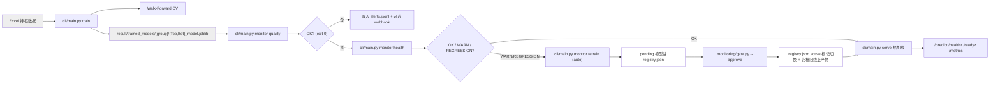

# tin-coating

镀锌线 Top / Bot 表面镀层重量偏差校正模型。基于 **HistGradientBoosting + 残差校正 + EWMA 平滑**，按规格组训练，Walk-Forward CV 验证。

**单一来源架构**：所有生产代码统一 import `tin_coating/` 子包，不再存在根目录旧脚本。训练、CV、重训、服务、运维入口全部通过 `cli/main.py` 或 `tin_coating.*` 直接调用；已从根目录删除的 15+ legacy 文件（`coating_model_by_group.py`、`legacy_*.py`、`model_persistence.py`、`archived/`、`surface_independent_modeling/` 等）里的逻辑已经物理搬入 `tin_coating/` 各子模块。

当前生产配置（`Top2.799_Bot2.799` 规格组，2813 样本）：

| 表面 | damping | pos_boost | lr    | depth | max_iter | Walk-Forward CV RMSE |
|---|---|---|---|---|---|---|
| Top  | 0.3046  | 1.6837    | 0.0144| 5     | 250      | 0.0506 ± 0.0060       |
| Bot  | 0.2848  | 1.2582    | 0.0117| 4     | 300      | 0.0554 ± 0.0052       |

统一 α=0.6（EWMA smoothing），random_state=42；Top/Bot 各 8 特征。健康检查显示在线 RMSE 提升 **-70% ~ -75%**。

---

## TL;DR

**我想先跑一下**：

```bash
cd Task1
pip install -e .                        # 安装（首次）
python run_full_flow.py --quick         # 一键跑全链（~30 秒，跳训练）
#  → 自检 5 项 OK → 质量门 PASS → 健康 OK → 200 行推理
```

**我想起 7×24 在线服务**：

```bash
python cli/main.py serve --host 0.0.0.0 --port 8080
#  /healthz /readyz /metrics /version /predict /reload
#  换模型自动热加载，无需重启
```

**我想部署一个新模型**：

```bash
python cli/main.py train                # 训练（更新 result/trained_models/）
python monitoring/gate.py --list       # 看 registry 里的版本历史
python monitoring/gate.py --approve Top2.799_Bot2.799 Top \
    --reason "CV 改进" --yes           # 审批部署
python monitoring/gate.py --rollback Top2.799_Bot2.799 Top --yes   # 回滚
```

> 训练只更新产物目录，**不会自动上线**。线上服务始终按 `monitoring/registry.json` 的 active 版本推理，必须走 `gate.py --approve`。

---

## 端到端闭环



---

## 安装

```bash
cd Task1
pip install -e .                         # 装 tin_coating + cli 包 + tin-coating 命令
pip install -r requirements.txt          # 锁定 sklearn<1.5 / pandas<2.2（推荐）
```

依赖：numpy / pandas / scikit-learn / matplotlib / seaborn / openpyxl / optuna / joblib / pyyaml。Python 3.9–3.11。

> ⚠️ **多环境 sklearn 反序列化坑**：registry 里的归档模型是用某个特定 sklearn 版本训练出来的。如果你换了 Python 环境（`.venv` vs anaconda），另一个环境的 sklearn 可能读不了旧模型，报错 `Can't get attribute '__pyx_unpickle_CyAbsoluteError'`。
>
> 此时 `ModelStore` 会自动退回 live 目录那份最新训练/部署的文件，**服务继续工作**但 `/version` 里标记 `fallback: true`、日志打 WARN。
>
> 消除 fallback：**同一环境训练 + gate --approve**；或者所有运行环境统一 `pip install -r requirements.txt`。

---

## Quick Path

### Path A：一键跑全链（推荐先跑这个）

```bash
python run_full_flow.py                 # 7 个 stage：自检 → 训练 → CV → EDA+诊断 → 质量门 → 健康检查 → 推理
python run_full_flow.py --quick         # 跳训练/CV/EDA+诊断，仅跑 自检+质量+健康+推理（~30 秒）
python run_full_flow.py --skip-train    # 复用现有模型，其余照跑
python run_full_flow.py --skip-analytics  # 跳过 EDA/残差/漂移/解释性（~48s，省时间）
python run_full_flow.py --with-retrain  # 额外生成重训候选（只产 pending，不部署）
python run_full_flow.py --rows 1000 --output result/predictions/my.xlsx
```

**7 个 stage 真实落盘**（exit code 0 = 全通，每个阶段单独 try/except，EDA+诊断套件里单个子模块 fail 不中断主流程）：

所有分析类产物都落在 **带 version 的目录** 下：`result/<module>/<group>/<version>/`，version = `YYYYMMDD_HHMMSS`（或 `--version` 指定），同时写 `result/_flows/<version>.json` 作为 MLflow params.txt 等价物（记录本次运行的 args、各 stage 耗时和 exit code）。每个 module/group 下写 `_LATEST.txt` / `_LATEST.json` 指针指向最新 version。

| Stage | 耗时 | 产物 |
|---|---|---|
| 启动自检 | < 1s | stdout 5 项 OK/WARN/FAIL |
| 正式训练 | ~110s | `result/trained_models/by_group/<group>/{Top,Bot}_{model.joblib,metadata.json}` + `result/grouped_by_coating_weight/fitting_result/{fitting_result,residual_analysis,residual_train_vs_test}/` Top/Bot × 3 png + `.../interpretation/{group}_{Top,Bot}/{test_set,val_set}/` permutation + PDP（**permutation importance 真跑，不再阉割**）|
| Walk-Forward CV | ~20s | `result/cv/<group>/<version>/cv_summary.json` + `result/cv/<group>/_LATEST.txt`（Top/Bot RMSE + MAE + folds 明细，**带 version 落盘**）|
| EDA + 诊断套件 | ~48s | `result/eda/<group>/<version>/{Top,Bot}/` 每面 6 png（pearson + spearman + MI + MI matrix + DCOR + DCOR matrix，**corr 全开**）+ `.../{pre,post}/` surface 预诊断 + `result/diagnostics/<group>/<version>/{Top,Bot}/residual/{distribution,heteroscedasticity,feature_relationship,temporal}/` 每面分布 + 异方差 + 残差 vs 特征 ×5 png + 时序 + `drift/drift_summary.txt` KS 漂移 + `interpretation/permutation_importance.{png,csv}` + `partial_dependence_both.png` |
| 数据质量门 | ~8s | `monitoring/reports/data_quality_*.json` |
| 月度健康检查 | ~8s | `monitoring/reports/monthly_health_*.json + .csv` |
| 批量推理 | ~1s | `result/predictions/full_flow_<时间戳>.xlsx` |
| **run_meta（自动写）** | — | `result/_flows/<version>.json`（args / 各 stage 耗时 / exit_code / artifacts 路径）+ `result/_flows/_LATEST.json` |

**版本化机制**：每次 run_full_flow 生成唯一 `_VERSION = YYYYMMDD_HHMMSS`，全程共用。所有分析类产物（cv / eda / diagnostics）都带 version 目录；模型产物（trained_models/）保持固定路径（因为模型有 registry.json 自己的版本管理，不跟 flow 耦合）。CLI 子命令（`cli eda corr` / `cli diagnose drift` / `cli cv`）默认写固定路径，如果跑多次会覆盖 —— 想版本化就走 `run_full_flow.py`。**flow 和 registry 是两条独立的版本链**：flow 管一次性分析产物的时间戳，registry 管模型 artifact 的 approve/rollback。

### Path B：起 7×24 在线服务

```bash
python cli/main.py serve --host 0.0.0.0 --port 8080
```

启动时先跑自检（配置 / registry / 模型产物 / 日志目录），任一致命项失败直接退出（fail-fast），不会带病上线。

**端点**：

| 端点 | 方法 | 用途 |
|---|---|---|
| `/healthz` | GET | 存活探针：进程能响应即 200 |
| `/readyz` | GET | 就绪探针：Top/Bot 模型都已加载才 200，否则 503 |
| `/metrics` | GET | Prometheus 文本指标（请求数 / 延迟直方图 / 就绪状态 / uptime）|
| `/version` | GET | 服务版本 + 每个表面的模型版本 + `fallback` 标记 |
| `/predict` | POST | 批量推理 |
| `/reload` | POST | 强制重载模型 |

**服务特性**：
- **热加载**：每次请求顺带检查 registry 的 active 版本 + 文件指纹（`(version, mtime_ns, size)`），换模型不用重启；新模型加载失败时**保留旧模型继续服务**并告警。
- **并发保护**：信号量限制并发 `service.max_concurrent_requests`（默认 4），排队超时返回 503；请求体上限 16MB，批大小上限 `service.max_batch_rows`（默认 5000）。
- **鉴权**：设置环境变量 `TIN_API_KEY` 后，`/predict`、`/reload` 需带 `X-API-Key`。
- **日志**：`monitoring/logs/service.jsonl`（结构化 JSON，10MB 轮转 5 份）；告警：`monitoring/logs/alerts.jsonl`。

`POST /predict` 示例：

```json
{"surface": "Top", "rows": [{"Tin Weight_Actual[g/m2]_GALV_WEIGHT_TOP_Avg": 2.81, "Speed[m/min]_Process_Avg": 120, "...": "..."}]}
```

内部自动构造 `{Top,Bot}_Current_Per_Speed` 衍生列，所以不用上游算好传进来。

### Path C：管理模型版本

```bash
# 1. 列出版本历史（含 active / pending / holdout RMSE / reason）
python monitoring/gate.py --list

# 2. 审批部署（默认选最新 pending）
python monitoring/gate.py --approve Top2.799_Bot2.799 Top \
    --version 2026-11-13_153000 --reason "walk-forward CV 改进" --yes

# 3. 回滚（精确回到上一次真正上线的版本，不跳错）
python monitoring/gate.py --rollback Top2.799_Bot2.799 Top --yes
```

所有版本历史写在 `monitoring/registry.json`，每条记录带 `version / cv_rmse_mean / cv_rmse_std / holdout_test_rmse / deploy_reason / previous_active / deployed_path / created_at`。

gate 审批时会**归档旧线上产物**到 `result/trained_models/.../_archive/{surface}_{version}.joblib`，再把新候选复制到线上路径，registry 记 `deployed_path`。回滚时直接用 `previous_active` 指针精确回退，不会踩到从没真正上线过的试验版本。

---

## 目录结构

### 只读代码（git 管）

```
Task1/
├── tin_coating/               # pip install 后的主包 — 所有生产逻辑
│   ├── config.py              #   统一配置加载器（点号访问 + 插值 + env 覆盖）
│   ├── data/                  #   清洗 / 特征工程 / 格式转换 / 合并
│   ├── modeling/              #   核心模型 / Walk-Forward CV / 持久化 / 调参
│   ├── inference/pipeline.py  #   PredictionPipeline 批量推理
│   ├── eda/                   #   探索性分析 + 分组诊断 + 解释器（Permutation/SHAP/PDP）
│   ├── diagnostics/           #   残差 / 漂移诊断
│   ├── ops/  ★                #   7×24 运维底座：结构化日志 / Prometheus 指标 / 跨平台 FileLock / 告警 / 自检 / 调度器
│   └── service/ ★             #   在线 HTTP 服务：/healthz /readyz /metrics /predict /version /reload
├── docs/CODEMAP.md            #   完整子模块文档
├── cli/main.py                # 统一 CLI 入口（argparse，零外部依赖）
├── run_full_flow.py           # 一键全流程编排脚本
├── monitoring/                # 监控闭环脚本（registry / gate / 质量门 / 健康检查 / 自动重训）
├── configs/                   # YAML 主配置 + 环境切换
│   ├── app.yaml               #   生产配置镜像（paths / service / ops / monitoring）
│   ├── default.yaml
│   ├── model/                 #   训练超参（每个规格组一个 JSON）
│   └── optuna/                #   Optuna 搜索的配置（可选）
├── pyproject.toml             # pip install -e . + tin-coating console_scripts
├── requirements.txt
├── pytest.ini / tests/        # 31 项 pytest
├── Dockerfile / docker-compose.yml / .dockerignore
├── group_params_2_799_only.json   # 生产超参（等价于 configs/model/ 下那份）
├── config.yaml                # merge.py 主副表合并脚本的主配置（data/merge.py 自引用）
├── rename_patch.yaml          # merge.py 列名更正补丁（data/merge.py 自引用）
└── README.md
```

### 运行时持久状态（要备份）

| 路径 | 内容 |
|---|---|
| `monitoring/registry.json` | 版本历史：各规格组 + 表面的版本、指标、active 标记、`previous_active` 指针、`deployed_path` |
| `result/trained_models/by_group/{group}/` | 每个规格组的在线产物：`{Top,Bot}_model.joblib` + `{Top,Bot}_metadata.json` |
| `result/trained_models/.../_archive/` | 归档的历史线上模型（`{surface}_{version}.joblib`）|
| `result/trained_models/.../.pending/` | 未审批的重训候选模型 |

### 运行时临时文件（可删、会自动清理）

| 路径 | 内容 | 清理策略 |
|---|---|---|
| `monitoring/logs/service.jsonl` 等 | 服务/ops/告警日志（结构化 JSON）| 文件轮转：10MB × 5 份（旧的自动淘汰）|
| `monitoring/logs/alerts.jsonl` | 告警事件（Notifier 落盘）| keep_logs_days=30 自动删除超过 30 天的日志/报告 |
| `monitoring/reports/*.json` | 质量门/健康检查/重训报告 | 同上 |
| `monitoring/locks/job_*.lock` / `registry.lock` | 跨进程 FileLock 占位 | 进程正常退出时释放；进程崩溃 OS 自动解锁；可手动删残留 |
| `result/predictions/full_flow_*.xlsx` | run_full_flow.py 产出 | 无自动清理 |

---

## CLI 参考

所有子命令返回**语义化 exit code**：`0` 正常 / `1` 警告 / `2` 失败 / `3` 跳过（ops run 锁冲突）。

```bash
python cli/main.py --help

# ── 训练 / 验证 ──
python cli/main.py train                         # 按 prod_config 跑正式训练（产物落盘 result/trained_models/）
python cli/main.py cv  --group Top2.799_Bot2.799 --surface Top   # Walk-Forward CV

# ── 推理 ──
python cli/main.py predict --input new.xlsx --output corrected.xlsx

# ── 数据分析 / 诊断 ──
python cli/main.py eda dist     --group Top2.799_Bot2.799           # 描述统计
python cli/main.py eda corr     --group Top2.799_Bot2.799           # 相关性 + MI + DCOR
python cli/main.py eda surface  --group Top2.799_Bot2.799           # 分组 EDA 预诊断
python cli/main.py diagnose drift     --group Top2.799_Bot2.799     # KS 漂移（残差前后 80/20 切分）
python cli/main.py diagnose residual   --group Top2.799_Bot2.799     # 残差分布 + QQ + ACF + 异方差
python cli/main.py diagnose interpret  --group Top2.799_Bot2.799     # Permutation + SHAP + PDP（SHAP 可选）

# ── 监控 ──
python cli/main.py monitor quality               # 数据质量门
python cli/main.py monitor health                # 月度健康检查
python cli/main.py monitor retrain --force       # 自动重训候选（产 .pending）
python cli/main.py monitor list --surface Top    # 列出 registry 版本
python cli/main.py monitor approve Top2.799_Bot2.799 Top --reason "改进" --yes
python cli/main.py monitor rollback Top2.799_Bot2.799 Top --yes

# ── 在线服务 ──
python cli/main.py serve --host 0.0.0.0 --port 8080

# ── 7×24 运维（给 cron/任务计划调用）──
python cli/main.py ops selfcheck                 # 上线前自检
python cli/main.py ops run --job quality         # 数据质量门
python cli/main.py ops run --job health          # 月度健康检查
python cli/main.py ops run --job retrain         # 自动重训候选
python cli/main.py ops run --job drift           # 在线漂移探针（KS-test）
python cli/main.py ops run --job report          # 聚合 quality + health + drift，写 weekly_overview JSON
```

直接用 Python API：

```python
import pandas as pd
from tin_coating import (
    ResidualCorrectionModel,
    run_cv_for_surface,
    load_pipeline_config,
    get_params_for_group,
    build_setpoint_group_key,
    PredictionPipeline,
    get_feature_cols,
)

df = pd.read_excel("result/data/feature_engineered_data/featured_data.xlsx")
df = build_setpoint_group_key(df)
group_df = df[df["Setpoint_Group_Label"] == "Top2.799_Bot2.799"].copy()

cfg = load_pipeline_config("group_params_2_799_only.json")
cv = run_cv_for_surface(group_df, "Top", get_params_for_group(cfg, "Top2.799_Bot2.799", "Top"))
print(f"Top RMSE = {cv['cv_rmse_mean']:.4f} ± {cv['cv_rmse_std']:.4f}")

pipeline = PredictionPipeline("result/trained_models/by_group/Top2.799_Bot2.799")
result = pipeline.predict_both_surfaces(group_df.head(50), group_label="Top2.799_Bot2.799")
```

---

## 7×24 运维

### 调度器（ops run）

```bash
python cli/main.py ops selfcheck                 # 5 项配置/registry/模型/日志目录/特征数据
python cli/main.py ops run --job quality
python cli/main.py ops run --job health
python cli/main.py ops run --job retrain
python cli/main.py ops run --job drift           # 在线漂移探针：KS-test（残差前后 80/20 切分），落盘 drift_<group>.json
python cli/main.py ops run --job report          # 聚合 quality + health + drift，落盘 weekly_overview_<group>.json
```

- **退出码**：`0` 正常 / `1` 警告 / `2` 失败 / `3` 跳过（文件锁 `job_<name>.lock` 已占用 → 上一轮未结束）
- **告警**：失败/警告自动写 `monitoring/logs/alerts.jsonl`；配置 `TIN_ALERT_WEBHOOK` 时同时 POST（指数退避 5→10→20s，任何异常内部吞掉，永不影响主流程）
- **锁**：跨进程 FileLock（Windows 用 msvcrt、POSIX 用 fcntl）；registry 读改写也走同一把锁，定时任务和人工操作不会互相覆盖
- **清理**：`keep_logs_days=30` 自动删除超过 30 天的日志 + 报告 JSON（不动 joblib / .lock）
- **drift job** 纯函数入口：`tin_coating.diagnostics.drift.ks_test_drift(values, ratio=0.8, ks_alpha=0.05, mean_diff_threshold=0.05)`，返回 `(ks_stat, ks_p, mean_diff, verdict ∈ {OK, WARN, DRIFT})`
- **report job** 汇总规则：`quality.pass=False` 或 `health.verdict=REGRESSION` 或 `drift.verdict=DRIFT` → FAIL；`health=WARN` 或 `drift=WARN` → WARN；其余 OK

### OS 调度示例

**Linux / cron**：

```cron
0 2 * * *    cd /opt/tin-coating/Task1 && python cli/main.py ops run --job quality  >> monitoring/logs/cron.log 2>&1
0 3 1 * *    cd /opt/tin-coating/Task1 && python cli/main.py ops run --job health   >> monitoring/logs/cron.log 2>&1
0 4 * * 0    cd /opt/tin-coating/Task1 && python cli/main.py ops run --job retrain  >> monitoring/logs/cron.log 2>&1
```

**Linux / systemd**（服务常驻 + 崩溃自动重启）：

```ini
# /etc/systemd/system/tin-coating.service
[Unit]
Description=Tin Coating Inference Service
After=network.target

[Service]
Type=simple
WorkingDirectory=/opt/tin-coating/Task1
Environment=TIN_COATING_ROOT=/opt/tin-coating/Task1
ExecStart=/usr/bin/python3 cli/main.py serve --host 0.0.0.0 --port 8080
Restart=always
RestartSec=5
KillSignal=SIGTERM

[Install]
WantedBy=multi-user.target
```

**Windows / 任务计划**：

```powershell
schtasks /Create /TN "TinCoating-Serve" /SC ONSTART /RU SYSTEM /RL HIGHEST /F /TR "cmd /c cd /d \"E:\SGAI_Project\2026\Tin coating\Task1\" && python cli/main.py serve"
schtasks /Create /TN "TinCoating-Quality" /SC DAILY /ST 02:00 /F /TR "cmd /c cd /d \"E:\SGAI_Project\2026\Tin coating\Task1\" && python cli/main.py ops run --job quality"
```

进程管理器（systemd / NSSM / 任务计划）只需保证：**进程异常退出后自动拉起；拉起后 `/readyz` 返回 200 即恢复服务**。

### 运维参数

`configs/app.yaml`：

```yaml
service:
  host: 0.0.0.0
  port: 8080
  max_batch_rows: 5000
  max_concurrent_requests: 4
  request_timeout_seconds: 30
  api_key_env: TIN_API_KEY

ops:
  lock_timeout_seconds: 5
  alert_webhook_env: TIN_ALERT_WEBHOOK
  keep_logs_days: 30
```

可用 `TIN_COATING__SERVICE__PORT=9090` 这类环境变量临时覆盖，无需改文件。`TIN_COATING_ROOT` / `TIN_COATING_ENV` 等"控制型"env var 不会被配置系统误消费。

### 容器化（已写，尚未验收）

```bash
docker build -t tin-coating:latest .
docker compose up -d
curl http://localhost:8080/readyz
docker compose logs -f tin-coating
```

> ⚠️ **Dockerfile / docker-compose.yml / .dockerignore 都已经写好**，但还没真跑过 `docker build`，`docker-compose.yml` 也没写 `healthcheck:` 和 `restart: unless-stopped`。上生产前必须亲自 build → 起 → `curl /readyz` → kill → 看自动重启 → 再 `/readyz` 一次。

---

## 测试矩阵

```bash
# 首选
pytest tests/                          # 当前 31 passed

# 单独跑的冒烟脚本（9 项）
python __main_smoke_test.py
```

| 文件 | 覆盖范围 |
|---|---|
| `tests/test_smoke.py` | 9 项：所有子包可 import、modeling 子包完整导出、Walk-Forward CV RMSE 范围、CLI cv/quality、目录布局、服务不重复定义 ResidualCorrectionModel、import 边界 |
| `tests/test_ops.py` | 结构化日志 JSON、Prometheus 指标渲染、`FileLock` 互斥、`Notifier` 文件通道、**`registry.json` 6 线程 × 5 次并发写不丢数据**、`run_selfcheck`、env override dotted key 隔离 meta env var |
| `tests/test_service.py` | 契约反例（缺列 / 空数组 / 非数值）+ **真实起服务**（随机端口 ThreadingHTTPServer）跑：`/healthz`、`/readyz`、`/metrics`、`/version`、`/predict` happy / both / 400 / 404、**并发 16 请求**、`ModelStore` 热加载（mtime 变化即重载）、**fallback 降级**（primary artifact 损坏但 live 目录可用 → ready=True）、**全部不可用时 ready=False**、API Key |

退出码任何一项 FAIL 会 exit 1 并打印明细。

---

## 关键约束（不要动）

| # | 约束 | 原因 |
|---|---|---|
| 1 | **所有生产代码 import 单一来源** — `tin_coating.*` / `monitoring.*` / `cli.main` | 2026-11 重构后旧脚本全部删除；任何顶层 .py 残留都应该是数据处理辅助脚本（如 `config.yaml` / `merge.py` 主副表合并） |
| 2 | **规格组过滤** — `Tin Weight_Setpoints[g/m2]_GALV_WEIGHT_TOP_Min` `.round(3) == 2.799`（Bot 同理）| 生产超参锁死；改这里等于换了生产模型的训练样本空间 |
| 3 | **Lab 列名是中文** — `上表面镀层重量A(XA1_0)` / `下表面镀层重量A(XA1_0)`，不是英文 `Top*` / `Bot*` | 上游 Excel 产线导出的列名；硬编码在监控脚本里 |
| 4 | **训练 ≠ 部署** — `train` / `run_full_flow.py` / `retrain` 只写 joblib + 进 pending，不碰 registry active 标记 | 必须走 `gate.py --approve` 才上线；回滚指针 `previous_active` 保证精确回到最近一次真正上线的版本 |

---

## 附录 A：常见坑

**Q：我的 sklearn 版本和 registry 归档模型对不上，跑推理报反序列化错？**  
A：ModelStore 会自动退回 live 目录产物（最近一次训练/部署的那份），服务不挂，`/version` 标记 `fallback: true`，日志打 WARN。长期解法：同一环境训练 + `gate --approve`，或所有运行环境 `pip install -r requirements.txt` 把 sklearn/pandas/numpy 版本对齐。

**Q：`ops run --job retrain` 返回 exit 3？**  
A：同一 job 上一轮还没结束，文件锁 `job_retrain.lock` 没释放（或上次崩溃残留）。可以手动删 `monitoring/locks/job_retrain.lock`，等进程退出或杀进程。

**Q：服务起来后 `/readyz` 返回 503？**  
A：Top 或 Bot 其中一个模型加载失败。先看 `/version` 里哪一面没 loaded、是不是 `fallback=false` 但 `path` 不存在；再看 `monitoring/logs/service.jsonl` 里 `model_load_failed` 那条的具体 err；再手动 `python monitoring/gate.py --list` 确认 registry.json 的 active 版本是否在、路径是否对。

**Q：我想换一个规格组（不是 `2.799`）训练和部署？**  
A：改 `configs/model/group_params_2_799_only.json`（或新建 JSON 然后 `cli/main.py train --config xxx.json`）里的 `target_groups` 数组，或者改 `app.yaml` 里的 `app.default_group`。CV 和质量门会按你传的 group 过滤。目前 pipeline 的 `default_group` 在 `configs/app.yaml`，可以改；多规格组矩阵跑法没做，要自己跑多次。

**Q：Docker 里起服务，模型怎么传进去？**  
A：`docker-compose.yml` 现在**没写卷挂载**。上生产前必须加上，把 `monitoring/registry.json`、`monitoring/logs/`、`result/trained_models/` 挂进容器的相应路径，否则每次容器重建模型和版本历史就丢了。
